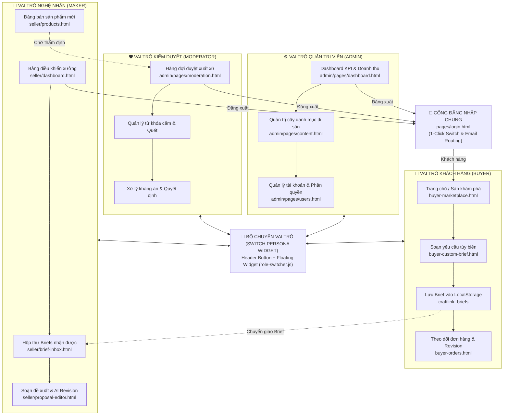

# Bảng Kiểm Kê Màn Hình – CraftLink

> **Dự án:** CraftLink – Sàn sản phẩm sáng tạo tùy biến  
> **Học phần:** Phát triển ứng dụng web cơ bản – CSE122  
> **Ngày cập nhật:** 25/10/2026 (Phiên bản hợp nhất toàn diện 4 Vai trò)  

---

## 1. Tổng quan các vai trò

| Vai trò | Số màn hình đã triển khai | Thư mục chính | Trạng thái |
|---|:---:|---|:---:|
| Dùng chung (Public / Core) | 5 | `Craftlink_website/`, `pages/` | ✅ Đã triển khai |
| Khách hàng (Buyer - SV1) | 4 | `pages/` | ✅ Đã triển khai |
| Người sáng tạo / Nghệ nhân (Maker - SV2) | 6+ | `seller/` | ✅ Đã triển khai |
| Kiểm duyệt viên (Moderator - SV3) | 3 | `admin/pages/` | ✅ Đã triển khai |
| Quản trị viên (Admin - SV3) | 3 | `admin/pages/`, `admin/` | ✅ Đã triển khai |
| **Bộ chuyển vai trò (Switch Persona)** | **Toàn hệ thống** | `assets/js/role-switcher.js` | ✅ **Hoạt động đa chiều** |

---

## 2. Bảng kiểm kê màn hình chi tiết

### 2.1. Màn hình dùng chung (Public / Shared)

| # | Tệp | Giao diện | CRUD / Trạng thái | AI | Mô tả chính | Người phụ trách | Trạng thái |
|:---:|---|---|---|:---:|---|:---:|:---:|
| S-01 | `index.html` | Trang chủ | R | — | Hero section, bộ sưu tập nổi bật, danh mục di sản, chỉ số tác động xã hội, câu chuyện nghệ nhân, Switch Persona | SV1 | ✅ |
| S-02 | `pages/login.html` | Đăng nhập chung tập trung | R/U | — | Cổng đăng nhập hợp nhất 4 vai trò: 1-Click Demo Quick Switch, phân luồng email thông minh, chuyển hướng tự động | SV1 & SV3 | ✅ |
| S-03 | `pages/impact.html` | Về chúng tôi & Tác động | R | — | Sứ mệnh CraftLink, bản đồ nghệ nhân, chỉ số tác động cộng đồng, timeline lịch sử di sản | SV1 | ✅ |
| S-04 | `pages/product.html` | Chi tiết sản phẩm | R | — | Gallery ảnh đa góc, thông tin chất liệu, câu chuyện bản sắc, đếm số lượng, thêm giỏ hàng | SV1 | ✅ |
| S-05 | `pages/buyer-cart.html` | Giỏ hàng | R/U/D | — | Quản lý sản phẩm giỏ hàng, cập nhật số lượng, xóa, tính tổng tiền, mô phỏng đặt hàng | SV1 | ✅ |

### 2.2. Khách hàng (Buyer - Phụ trách: SV1)

| # | Tệp | Giao diện | Mục tiêu người dùng | Nhiệm vụ người dùng | CRUD / Trạng thái | AI | Trạng thái |
|:---:|---|---|---|---|---|:---:|:---:|
| B-01 | `pages/buyer-marketplace.html` | Sàn Khám Phá (Marketplace) | Tìm sản phẩm thủ công | Duyệt, tìm kiếm, lọc theo dân tộc / vùng miền / chất liệu / giá, sắp xếp | R | AI-2 (Style Matcher) | ✅ |
| B-02 | `pages/buyer-custom-brief.html` | Tạo Yêu Cầu Tùy Biến (Brief) | Diễn đạt yêu cầu tùy biến | Điền form brief: tiêu đề, ngân sách, mô tả, deadline, đính kèm ảnh; xem trước; lưu vào LocalStorage | C/R/U | AI-1 (Brief Builder) | ✅ |
| B-03 | `pages/buyer-orders.html` | Quản lý Đơn Hàng Tùy Biến | Theo dõi tiến độ chế tác | Xem danh sách đơn, lọc theo trạng thái (chờ, đang làm, hoàn thành, hủy), xem chi tiết, hủy đơn | C/R/U/D | AI-3 (Revision Summarizer) | ✅ |
| B-04 | `pages/buyer-cart.html` | Giỏ hàng & Thanh toán | Quản lý đơn giỏ | Xem giỏ, thay đổi số lượng, xóa, tính tổng hóa đơn | R/U/D | — | ✅ |

### 2.3. Người sáng tạo / Nghệ nhân (Maker / Seller - Phụ trách: SV2)

| # | Tệp | Giao diện | Mục tiêu người dùng | Nhiệm vụ người dùng | CRUD / Trạng thái | AI | Trạng thái |
|:---:|---|---|---|---|---|:---:|:---:|
| M-01 | `seller/dashboard.html` | Bảng điều khiển Xưởng | Quản lý hiệu suất xưởng | Theo dõi doanh thu, trạng thái đơn chế tác, chỉ số brief mới, chuyển nhanh vai | R | — | ✅ |
| M-02 | `seller/brief-inbox.html` | Hộp Brief Nhận Được | Xem và phản hồi brief của khách | Nhận brief từ Buyer (qua LocalStorage), lọc theo trạng thái, xem modal chi tiết, từ chối/tiếp nhận | R/U | AI-2 (Style Matcher) | ✅ |
| M-03 | `seller/proposal-editor.html` | Soạn Đề Xuất (Proposal) | Gửi báo giá & kế hoạch chế tác | Soạn chi phí vật liệu, nhân công, mốc thời gian, đính kèm ảnh mẫu, gửi cho Buyer | C/R/U/D | AI-3 (Revision Summarizer) | ✅ |
| M-04 | `seller/products.html` | Quản lý Sản Phẩm (Listing) | Quản lý danh mục hàng bán | Xem danh sách listing, lọc kho hàng, xem trạng thái kiểm duyệt, xóa sản phẩm | C/R/U/D | — | ✅ |
| M-05 | `seller/product-form.html` | Thêm / Sửa Sản Phẩm | Đăng bán tác phẩm mới | Nhập thông tin di sản, tải ảnh, chứng nhận làng nghề, gửi hàng đợi kiểm duyệt | C/U | — | ✅ |
| M-06 | `seller/orders.html` | Quản lý Đơn Hàng | Theo dõi giao hàng & chế tác | Cập nhật tiến độ hoàn thiện tác phẩm, chi tiết đơn hàng (`order-detail.html`) | R/U | — | ✅ |

### 2.4. Kiểm duyệt viên (Moderator - Phụ trách: SV3)

| # | Tệp | Giao diện | Mục tiêu người dùng | Nhiệm vụ người dùng | CRUD / Trạng thái | AI | Trạng thái |
|:---:|---|---|---|---|---|:---:|:---:|
| D-01 | `admin/pages/moderation.html` | Hàng Đợi Kiểm Duyệt Di Sản | Duyệt listing & chứng nhận | Thẩm định sản phẩm làng nghề mới, kiểm tra tiêu chuẩn WFTO, phê duyệt hoặc từ chối có lý do | R/U | — | ✅ |
| D-02 | `admin/pages/moderation.html` | Quản Trị Từ Khóa Cấm | Chống gian lận & từ ngữ xấu | Thêm từ khóa cấm, xóa từ khóa, mô phỏng quét tự động nội dung vi phạm | C/R/D | Quét từ khóa tự động | ✅ |
| D-03 | `admin/pages/moderation.html` | Trung Tâm Xử Lý Kháng Án | Giải quyết khiếu nại của Maker | Xem đơn kháng án của Maker, mở modal quyết định: Giữ nguyên từ chối / Đảo ngược quyết định / Chuyển hội đồng | R/U | — | ✅ |

### 2.5. Quản trị viên (Admin - Phụ trách: SV3)

| # | Tệp | Giao diện | Mục tiêu người dùng | Nhiệm vụ người dùng | CRUD / Trạng thái | AI | Trạng thái |
|:---:|---|---|---|---|---|:---:|:---:|
| A-01 | `admin/pages/dashboard.html` / `admin/index.html` | Bảng Điều Khiển Nền Tảng | Giám sát toàn sàn | Theo dõi KPI doanh thu, tăng trưởng người dùng, biểu đồ giao dịch, ghi đè trạng thái tranh chấp (Override Dispute) | R/U | — | ✅ |
| A-02 | `admin/pages/content.html` | Quản Lý Danh Mục & Taxonomy | Quản lý phân loại di sản | Xem cây danh mục, thêm mới, sửa slug/thứ tự, chuyển đổi trạng thái, xóa danh mục | C/R/U/D | — | ✅ |
| A-03 | `admin/pages/users.html` | Quản Lý Tài Khoản & Quyền | Quản trị thành viên sàn | Tìm kiếm, lọc theo vai trò (Buyer, Maker, Mod, Admin), đổi quyền, khóa/mở tài khoản, cấp lại mật khẩu | C/R/U/D | — | ✅ |

---

## 3. Ma trận Tính năng AI

| Tính năng AI | Mô tả | Màn hình áp dụng | Cơ chế triển khai / Mô phỏng | Trạng thái |
|---|---|---|---|:---:|
| **AI-1: Brief Builder** | Chuyển đổi mô tả tự do của khách thành bản Creative Brief có cấu trúc chuẩn | B-02 (`pages/buyer-custom-brief.html`) | Phân tích từ khóa JavaScript + mô phỏng phân tích gợi ý phong cách, chất liệu, hạn mức | ✅ |
| **AI-2: Style Matcher** | Ghép cặp brief tùy biến với nghệ nhân / xưởng chế tác phù hợp về bản sắc văn hóa | B-01 (`buyer-marketplace.html`) & M-02 (`seller/brief-inbox.html`) | Thuật toán so khớp thuộc tính dân tộc, vùng miền (Tây Bắc, Tây Nguyên), chất liệu (chàm, thổ cẩm) | ✅ |
| **AI-3: Revision Summarizer** | Tóm tắt ý kiến phản hồi sửa đổi nhiều vòng của khách để nghệ nhân cập nhật proposal | B-03 (`buyer-orders.html`) & M-03 (`seller/proposal-editor.html?mode=ai-revision`) | Tự động trích xuất ý chính từ `latestCustomerFeedback` và hiển thị giải pháp sửa đổi | ✅ |

---

## 4. Bao phủ trạng thái trên toàn hệ thống

| Trạng thái | Trang chủ | Đăng nhập | Sàn khám phá | Tạo Brief | Đơn hàng | Xưởng Maker | Kiểm duyệt Mod | Dashboard Admin |
|---|:---:|:---:|:---:|:---:|:---:|:---:|:---:|:---:|
| **Bình thường (Normal)** | ✅ | ✅ | ✅ | ✅ | ✅ | ✅ | ✅ | ✅ |
| **Đang tải (Loading)** | — | — | ✅ | ✅ | — | ✅ | ✅ | ✅ |
| **Rỗng (Empty)** | — | — | ✅ | — | ✅ | ✅ | ✅ | — |
| **Thành công (Success)** | — | ✅ | — | ✅ | — | ✅ | ✅ | ✅ |
| **Lỗi validation (Error)** | — | ✅ | — | ✅ | — | ✅ | ✅ | ✅ |
| **Vô hiệu hóa (Disabled)** | — | — | — | ✅ | — | ✅ | — | ✅ |
| **Đang chờ (Pending)** | — | — | — | — | ✅ | ✅ | ✅ | — |
| **Hoàn thành (Done)** | — | — | — | — | ✅ | ✅ | ✅ | ✅ |
| **Đã hủy / Khóa (Banned)** | — | — | — | — | ✅ | ✅ | ✅ | ✅ |

---

## 5. Sơ đồ User Flow liên vai trò (End-to-End Persona Flow)



---

## 6. Cấu trúc tệp dự án sau khi hợp nhất

```
Craftlink_website/
├── index.html                                  ← Trang chủ nền tảng (Buyer)
├── pages/
│   ├── login.html                              ← Cổng đăng nhập chung cho cả 4 vai trò
│   ├── buyer-marketplace.html                  ← Sàn khám phá sản phẩm di sản (Buyer)
│   ├── buyer-custom-brief.html                 ← Tạo yêu cầu tùy biến riêng (Buyer)
│   ├── buyer-orders.html                       ← Quản lý đơn hàng tùy biến (Buyer)
│   ├── buyer-cart.html                         ← Giỏ hàng & thanh toán (Buyer)
│   ├── product.html                            ← Chi tiết tác phẩm di sản (Buyer)
│   └── impact.html                             ← Tác động xã hội & cộng đồng làng nghề (Buyer)
├── seller/                                     ← PHÂN HỆ NGHỆ NHÂN / NGƯỜI BÁN (MAKER - SV2)
│   ├── dashboard.html                          ← Bảng điều khiển hiệu suất xưởng thủ công
│   ├── brief-inbox.html                        ← Hộp thư tiếp nhận brief từ Buyer
│   ├── proposal-editor.html                    ← Soạn đề xuất chế tác & AI Revision
│   ├── products.html                           ← Quản lý danh mục sản phẩm đăng bán
│   ├── product-form.html                       ← Biểu mẫu đăng bán sản phẩm mới
│   ├── orders.html & order-detail.html         ← Quản lý đơn hàng & chi tiết chế tác
│   ├── inventory.html                          ← Quản lý kho nguyên vật liệu
│   ├── revenue.html                            ← Báo cáo doanh số & lợi nhuận
│   ├── promotions.html                         ← Chương trình ưu đãi khách hàng
│   ├── reviews-messages.html                   ← Đánh giá tác phẩm & tin nhắn
│   ├── shop-profile.html & settings.html       ← Hồ sơ xưởng thủ công & cấu hình
│   ├── seller-data.js                          ← Mock data chuyên biệt phân hệ Maker
│   ├── seller.js                               ← Logic layout, header, drawer và switch persona Maker
│   └── login.html                              ← Tự động chuyển hướng về pages/login.html
├── admin/                                      ← PHÂN HỆ KIỂM DUYỆT & QUẢN TRỊ (MOD & ADMIN - SV3)
│   ├── index.html                              ← Lối vào Bảng quản trị tổng hợp
│   ├── pages/
│   │   ├── dashboard.html                      ← Bảng điều khiển KPI & Override Dispute (Admin)
│   │   ├── moderation.html                     ← Hàng đợi kiểm duyệt di sản & Kháng án (Moderator)
│   │   ├── content.html                        ← Quản lý Danh mục & Phân loại Taxonomy (Admin)
│   │   ├── users.html                          ← Quản lý Tài khoản & Phân quyền 4 role (Admin)
│   │   └── login.html                          ← Tự động chuyển hướng về pages/login.html
│   ├── js/
│   │   ├── common/
│   │   │   ├── header.js                       ← Header kính mờ đồng bộ Buyer, Mobile Drawer
│   │   │   ├── sidebar.js                      ← Đăng xuất logoutDemo() chuẩn hóa
│   │   │   ├── modal.js                        ← Quản lý đóng mở modal an toàn (Escape, backdrop)
│   │   │   └── notification.js                 ← Chuông thông báo hệ thống realtime
│   │   └── pages/                              ← Logic nghiệp vụ từng trang admin/moderation
│   ├── css/                                    ← Stylesheet cấu phần admin
│   └── login.html                              ← Tự động chuyển hướng về pages/login.html
├── assets/
│   ├── css/
│   │   ├── base.css                            ← Quy tắc responsive nền tảng, modal utilities
│   │   ├── colors.css                          ← Hệ thống mã màu thổ cẩm & đất nung
│   │   └── tailwind.css                        ← Tailwind stylesheet dựng sẵn
│   └── js/
│       ├── role-switcher.js                    ← Hệ thống Switch Persona chuyển vai toàn sàn
│       ├── responsive-nav.js                   ← Tự động điều khiển Navbar/Drawer theo kích thước
│       ├── data.js                             ← Mock data sản phẩm di sản ban đầu
│       ├── thocam.js                           ← Logic bộ lọc đa tiêu chí sàn khám phá
│       └── tailwind-config.js                  ← Cấu hình Tailwind theme tokens
└── docs/
    ├── assignment-craftlink.md                 ← Đặc tả đề bài BTL-11
    ├── design-system.md                        ← Hệ thống thiết kế chuẩn hóa đa vai trò
    ├── screen-inventory.md                     ← Bảng kiểm kê màn hình chi tiết (tệp này)
    └── ai-usage-report.md                      ← Báo cáo trung thực sử dụng công cụ AI
```

---

## 7. Dữ liệu & Lưu trữ tương tác

| Nguồn dữ liệu | Cơ chế tương tác | Phạm vi áp dụng |
|---|---|---|
| **LocalStorage (`craftlink_briefs`)** | Lưu trữ CRUD brief từ Buyer và tải sang Brief Inbox của Maker | Khách hàng đặt làm riêng $\leftrightarrow$ Nghệ nhân nhận việc |
| **LocalStorage (`craftlink_current_role`)** | Ghi nhớ vai trò hiện tại khi chuyển trang hoặc đăng nhập | Switch Persona toàn hệ sinh thái |
| **Mock Products Data (`data.js`)** | 6+ bộ sưu tập di sản bản địa có xuất xứ làng nghề | Buyer Marketplace, Chi tiết sản phẩm |
| **Seller Data Module (`seller-data.js`)** | Kho dữ liệu đơn chế tác, proposal, kho hàng xưởng | Toàn bộ phân hệ Maker |
| **Admin In-Memory State (`data.js`)** | Dữ liệu kiểm duyệt, danh mục, phân quyền tài khoản, từ khóa cấm | Toàn bộ phân hệ Moderator & Admin |

---

## 8. Bảng kiểm tra chất lượng hoàn thành (Checklist)

| Tiêu chí kỹ thuật | Dùng chung (Public) | Buyer (SV1) | Maker (SV2) | Moderator (SV3) | Admin (SV3) |
|---|:---:|:---:|:---:|:---:|:---:|
| **HTML Semantic** | ✅ | ✅ | ✅ | ✅ | ✅ |
| **CSS Design System** | ✅ | ✅ | ✅ | ✅ | ✅ |
| **Responsive (320px - 1440px)** | ✅ | ✅ | ✅ | ✅ | ✅ |
| **Tương tác DOM / JavaScript** | ✅ | ✅ | ✅ | ✅ | ✅ |
| **Kiểm tra hợp lệ biểu mẫu (Validation)** | ✅ | ✅ | ✅ | ✅ | ✅ |
| **Dữ liệu giả lập & Liên kết Role** | ✅ | ✅ | ✅ | ✅ | ✅ |
| **Trải nghiệm mô phỏng AI** | — | ✅ (AI-1, AI-2) | ✅ (AI-2, AI-3) | ✅ (Auto-Scan) | — |
| **Switch Persona & Logout đồng bộ** | ✅ | ✅ | ✅ | ✅ | ✅ |
